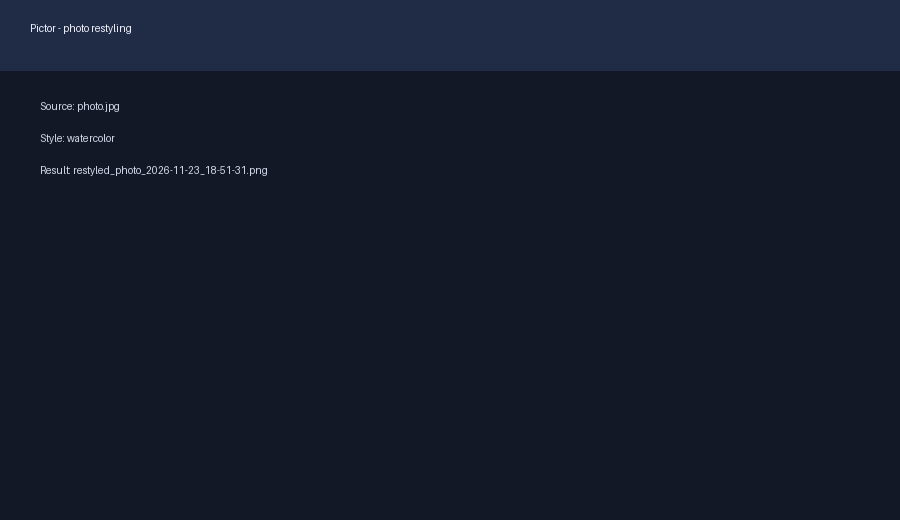

English | [Русский](README.ru.md)

# Pictor

**A personal AI artist that understands Russian and English in your terminal.**


Pictor turns a text description into a polished image and restyles a photograph according to a style you describe. It keeps the process simple: choose an action in a Russian terminal menu, enter a prompt in Russian or English, and receive a PNG in `output/`.

The application accepts mixed or naturally written requests without a language switch. Russian prompts are sent directly with Russian instructions to the OpenAI Images API, which models can interpret alongside English. API configuration and source-language handling stay separate from image and menu logic.

## Features

- Generate images from short or detailed prompts in Russian or English.
- Restyle a local photo while preserving its recognizable subjects and composition.
- Validate image files and normalize orientation, format, and dimensions before upload.
- Save results with timestamped, readable filenames and automatic numeric suffixes.
- Review all generated PNG, JPG, JPEG, and WebP files in the built-in history.
- Receive friendly Russian status messages and API, network, key, and file errors.
- Return to the menu after every operation; Pictor never leaves a traceable secret in a message or log.

## Screenshots

> Add real screenshots as `docs/screenshots/menu.png`, `docs/screenshots/generation.png`, and `docs/screenshots/restyle.png`. The relative paths work identically in both README files.

### Menu


### Text-to-image example


### Photo restyling example



## Installation

### 1. Clone the repository

```bash
git clone https://github.com/YOUR_USERNAME/pictor.git
cd pictor
```

### 2. Create a virtual environment

**Windows (PowerShell):**

```powershell
py -3.10 -m venv .venv
.venv\Scripts\Activate.ps1
```

**macOS / Linux:**

```bash
python3 -m venv .venv
source .venv/bin/activate
```

If PowerShell blocks activation on Windows, run PowerShell as usual and execute:

```powershell
Set-ExecutionPolicy -Scope Process -ExecutionPolicy Bypass
```

### 3. Install dependencies

```bash
python -m pip install --upgrade pip
pip install -r requirements.txt
```

The pinned dependencies are `openai==1.109.1`, `Pillow==11.3.0`, and `python-dotenv==1.1.1`.

### 4. Configure the API key

1. Create an account at [OpenAI Platform](https://platform.openai.com/).
2. Open [API keys](https://platform.openai.com/api-keys) and create a secret key.
3. Copy `.env.example` to `.env` in the project root.
4. Paste the key after `OPENAI_API_KEY=`. Do not add quotes or commit `.env`.

Example:

```dotenv
OPENAI_API_KEY=your-key-here
PICTOR_IMAGE_MODEL=gpt-image-1
PICTOR_IMAGE_SIZE=1024x1024
```

Never paste a real key into README examples, source files, issues, or screenshots.

## Run

```bash
python -m pictor
```

You will see the Russian menu:

```text
1. Нарисовать по описанию
2. Перерисовать моё фото
3. История
4. Выход
```

Choose `1` for text-to-image or `2` to restyle a photograph. Pictor prints the saved path when a request succeeds.

## Prompt examples

**Text prompts:**

- `пионы акварелью на светлом фоне`
- `грустный кот под дождём в стиле аниме`
- `a bouquet of peonies in soft morning light`
- `a tiny red cabin beside a snowy mountain, cinematic`
- `fantasy library, floating candles, watercolor, highly detailed`
- `тихая улица ночного Токио после дождя`
- `futuristic greenhouse with glass domes and mist`

**Restyling descriptions:**

- `акварель`
- `карандашный рисунок`
- `аниме`
- `масляная живопись`
- `неоновый киберпанк`
- `как у Ван Гога`
- `watercolor`
- `pencil sketch`
- `anime style`
- `oil painting`
- `neon cyberpunk`
- `Vincent van Gogh style`

## How it works

```text
pictor/
  __init__.py       Package metadata
  __main__.py       python -m pictor entry point
  cli.py            Russian menu and user flow
  config.py         Environment and .env configuration
  language.py       Language detection and prompt enrichment
  images.py         Validation, normalization, naming, and history
  api.py            OpenAI Images API calls and safe error mapping
output/             Generated PNG files
docs/screenshots/   Shared README screenshots
.env.example        Secret configuration template
requirements.txt    Pinned dependencies
```

- `config.py` loads `.env` only from the project root and never prints secrets.
- `language.py` detects Cyrillic input and leaves future third-language support in a central language registry.
- `images.py` creates `output/`, prepares local photos, and adds numeric suffixes instead of overwriting.
- `api.py` translates network, timeout, key, rate-limit, content, and server failures into short Russian explanations.
- `output/` is ignored by Git. Source photos remain in their original location.

## Cost

Pictor uses a paid OpenAI Images API by default. A call can consume paid API credits even if no image is saved. The per-image rate changes by model, size, and OpenAI pricing, so check [OpenAI pricing](https://openai.com/api/pricing/) before generating large batches. Start with one low-resolution request and monitor usage in the OpenAI account dashboard.

## Limitations

- Pictor requires internet access and an active OpenAI API key.
- It does not guarantee a perfect match to the prompt or photographic details.
- A style request may not accurately imitate a living artist or preserve every detail.
- Commercial use must be checked against the applicable API terms and model license.
- Image content policies may reject a prompt or photograph.

## Future plans

- Run a local/open-source image model for offline use.
- Add a lightweight web interface.
- Add a third input language through `SUPPORTED_LANGUAGES`.
- Add a batch-generation mode.
- Add optional automatic prompt translation and style presets.

## Contributing

Contributions are welcome. Read [CONTRIBUTING.md](CONTRIBUTING.md) for setup, style, tests, issues, and pull requests.

## License

Pictor is released under the [MIT License](LICENSE). Replace `[Your Name]` in `LICENSE` with the copyright holder before publishing.

## Acknowledgements

Pictor is built with Python, Pillow, python-dotenv, and the OpenAI Python SDK.
