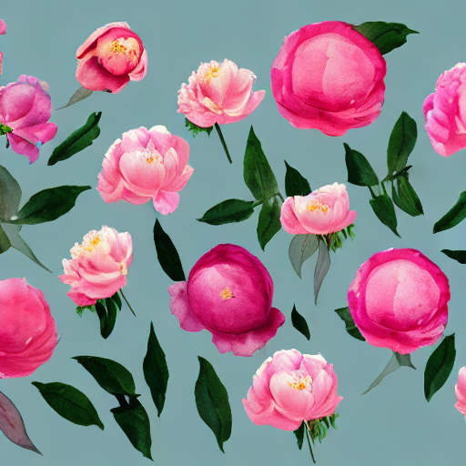

English | [Русский](README.ru.md)

# Pictor

**A personal AI artist that understands Russian and English in your terminal.**


Pictor turns a text description into an image and restyles photographs in a Russian terminal menu. Its default provider is Stable Diffusion running locally on your computer: there is no per-image API charge, and photos are not sent to an image-generation service.

The model is downloaded once from Hugging Face and cached on disk. After that, generation runs locally and can work offline. A GPU is not required, but CPU generation is slow. English prompts generally work best with this model; Russian input is accepted, though output quality can vary.

## Features

- Generate images from short or detailed prompts in Russian or English.
- Restyle a local photo while preserving its recognizable subjects and composition.
- Pick a ready-made photo-restyling style from a clear Russian menu, or enter your own.
- Validate image files and normalize orientation, format, and dimensions before local restyling.
- Save results with timestamped, readable filenames and automatic numeric suffixes.
- Review all generated PNG, JPG, JPEG, and WebP files in the built-in history.
- Receive friendly Russian status messages and clear model, network, and file errors.
- Return to the menu after every operation; Pictor never leaves a traceable secret in a message or log.

## Screenshots

This is an actual flower image generated by Pictor's local model on a CPU-only Windows computer.



## Installation

### 1. Clone the repository

```bash
git clone https://github.com/artdengpo/pictor.git
cd pictor
```

### 2. Create a virtual environment

**Windows (PowerShell):**

```powershell
py -3.12 -m venv .venv
.\.venv\Scripts\Activate.ps1
```

**macOS / Linux:**

```bash
python3.12 -m venv .venv
source .venv/bin/activate
```

If PowerShell blocks activation on Windows, run PowerShell as usual and execute:

```powershell
Set-ExecutionPolicy -Scope Process -ExecutionPolicy Bypass
```

### 3. Install dependencies

```bash
python -m pip install --upgrade pip
pip install -r requirements.txt
```

This installs the local Stable Diffusion stack, including PyTorch. The download is large (several gigabytes). A computer with a supported NVIDIA GPU is faster; CPU-only generation works but can take several minutes per image.

### 4. Configure the local model cache

Pictor defaults to local generation and needs no API key. To put the downloaded model cache on `D:` in Windows PowerShell, set this user environment variable once:

```powershell
[Environment]::SetEnvironmentVariable("HF_HOME", "D:\huggingface-cache", "User")
```

Close and reopen the terminal after changing the variable. The first run downloads the model; keep the terminal open until download and model loading finish. The model license and usage restrictions still apply even though generation does not incur an API charge.

Optional paid provider: copy `.env.example` to `.env`, set `PICTOR_PROVIDER=openai`, and add an OpenAI API key. API usage is billed separately. Never commit `.env`.

Local configuration example:

```dotenv
PICTOR_PROVIDER=local
PICTOR_LOCAL_MODEL=runwayml/stable-diffusion-v1-5
PICTOR_LOCAL_DEVICE=auto
```

## Run

```bash
python -m pictor
```

You will see the Russian menu:

```text
1. Нарисовать по описанию
2. Перерисовать моё фото
3. История
4. Выход
```

Choose `1` for text-to-image or `2` to restyle a photograph. Pictor prints the saved path when a request succeeds. The first run downloads and loads the model; keep the terminal open.

## Prompt examples

**Text prompts:**

- `пионы акварелью на светлом фоне`
- `грустный кот под дождём в стиле аниме`
- `a bouquet of peonies in soft morning light`
- `a tiny red cabin beside a snowy mountain, cinematic`
- `fantasy library, floating candles, watercolor, highly detailed`
- `тихая улица ночного Токио после дождя`
- `futuristic greenhouse with glass domes and mist`

**Restyling descriptions:**

When you choose photo restyling, select a preset by number: `1` watercolor, `2` pencil, `3` oil paint, `4` soft illustration, or `5` subtle color changes only. Choose `6` to enter your own style.

- `акварель`
- `карандашный рисунок`
- `аниме`
- `масляная живопись`
- `неоновый киберпанк`
- `как у Ван Гога`
- `watercolor`
- `pencil sketch`
- `anime style`
- `oil painting`
- `neon cyberpunk`
- `Vincent van Gogh style`

## How it works

```text
pictor/
  __init__.py       Package metadata
  __main__.py       python -m pictor entry point
  cli.py            Russian menu and user flow
  config.py         Environment and .env configuration
  language.py       Language detection and prompt enrichment
  images.py         Validation, normalization, naming, and history
  api.py            Optional OpenAI API calls and safe error mapping
  local_provider.py Local Stable Diffusion generation and restyling
output/             Generated PNG files
docs/screenshots/   Shared README screenshots
.env.example        Secret configuration template
requirements.txt    Pinned dependencies
```

- `config.py` loads `.env` only from the project root and never prints secrets.
- `language.py` detects Cyrillic input and leaves future third-language support in a central language registry.
- `images.py` creates `output/`, prepares local photos, and adds numeric suffixes instead of overwriting.
- `local_provider.py` runs Stable Diffusion locally; set `HF_HOME` to move its model cache to another drive.
- Photo restyling uses a low image-to-image strength to reduce changes to people, objects, and layout; results can still differ from the original.
- `api.py` is only used when the optional paid OpenAI provider is selected.
- `output/` is ignored by Git. Source photos remain in their original location.

## Cost

The default local mode has no per-image API fee. It uses your computer's hardware and electricity, and needs internet to download the model the first time. The optional OpenAI provider is paid; check [OpenAI pricing](https://openai.com/api/pricing/) before enabling it.

## Limitations

- The first local launch requires internet to download the model; later generation can run offline.
- CPU-only generation is slow and uses substantial memory; a compatible GPU is recommended.
- Russian text is accepted, but this Stable Diffusion model usually follows English prompts more reliably.
- It does not guarantee a perfect match to the prompt or photographic details.
- A style request may not preserve every detail. Check the model license before commercial use.

## Future plans

- Add a lightweight web interface.
- Add a third input language through `SUPPORTED_LANGUAGES`.
- Add a batch-generation mode.
- Add optional automatic prompt translation and style presets.

## Contributing

Contributions are welcome. Read [CONTRIBUTING.md](CONTRIBUTING.md) for setup, style, tests, issues, and pull requests.

## License

Pictor is released under the [MIT License](LICENSE). Replace `[Your Name]` in `LICENSE` with the copyright holder before publishing.

## Acknowledgements

Pictor is built with Python, PyTorch, Diffusers, Pillow, and the Hugging Face ecosystem.
