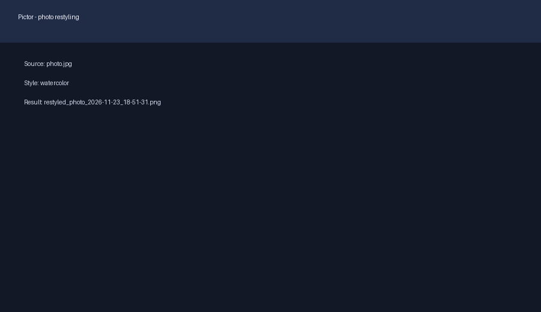

[English](README.md) | Русский

# Pictor

**Персональный AI-художник, который понимает русский и английский прямо в терминале.**


Pictor превращает текстовое описание в готовое изображение и перерисовывает фотографию в заданном стиле. Процесс прост: в русскоязычном меню выберите действие, введите запрос на русском или английском и получите PNG-файл в папке `output/`.

Приложение принимает естественно сформулированные запросы без переключения языка. Русские промты отправляются непосредственно вместе с русскими инструкциями в OpenAI Images API, который может интерпретировать русский и английский языки. Настройки API и определение языка отделены от логики изображений и интерфейса.

## Возможности

- Генерация изображений из коротких или подробных промтов на русском и английском.
- Перерисовка локального фото с сохранением узнаваемых объектов и композиции.
- Проверка изображения и нормализация ориентации, формата и размеров перед отправкой.
- Сохранение результатов с датой, понятным именем и автоматическим числовым суффиксом.
- Просмотр всех PNG, JPG, JPEG и WebP-файлов в встроенной истории.
- Дружелюбные русские статусы и понятные ошибки API, сети, ключа и файла.
- Возврат в меню после каждой операции: Pictor не помещает секреты в сообщения или логи.

## Скриншоты

> Добавьте реальные скриншоты как `docs/screenshots/menu.png`, `docs/screenshots/generation.png` и `docs/screenshots/restyle.png`. Относительные пути одинаково работают в обеих версиях README.

### Меню


### Пример генерации текста в изображение


### Пример перерисовки фото



## Установка

### 1. Клонируйте репозиторий

```bash
git clone https://github.com/YOUR_USERNAME/pictor.git
cd pictor
```

### 2. Создайте виртуальное окружение

**Windows (PowerShell):**

```powershell
py -3.10 -m venv .venv
.venv\Scripts\Activate.ps1
```

**macOS / Linux:**

```bash
python3 -m venv .venv
source .venv/bin/activate
```

Если Windows PowerShell блокирует активацию, выполните в обычном PowerShell:

```powershell
Set-ExecutionPolicy -Scope Process -ExecutionPolicy Bypass
```

### 3. Установите зависимости

```bash
python -m pip install --upgrade pip
pip install -r requirements.txt
```

Зафиксированные зависимости: `openai==1.109.1`, `Pillow==11.3.0` и `python-dotenv==1.1.1`.

### 4. Настройте API-ключ

1. Создайте аккаунт на [OpenAI Platform](https://platform.openai.com/).
2. Откройте [API keys](https://platform.openai.com/api-keys) и создайте секретный ключ.
3. Скопируйте `.env.example` в `.env` в корне проекта.
4. Вставьте ключ после `OPENAI_API_KEY=`. Не используйте кавычки и не коммитьте `.env`.

Пример:

```dotenv
OPENAI_API_KEY=your-key-here
PICTOR_IMAGE_MODEL=gpt-image-1
PICTOR_IMAGE_SIZE=1024x1024
```

Никогда не вставляйте настоящий ключ в примеры README, исходники, issue или скриншоты.

## Запуск

```bash
python -m pictor
```

Вы увидите русскоязычное меню:

```text
1. Нарисовать по описанию
2. Перерисовать моё фото
3. История
4. Выход
```

Выберите `1` для генерации из текста или `2` для перерисовки фото. После успеха Pictor напечатает путь к сохранённому файлу.

## Примеры запросов

**Текстовые запросы:**

- `пионы акварелью на светлом фоне`
- `грустный кот под дождём в стиле аниме`
- `a bouquet of peonies in soft morning light`
- `a tiny red cabin beside a snowy mountain, cinematic`
- `fantasy library, floating candles, watercolor, highly detailed`
- `тихая улица ночного Токио после дождя`
- `futuristic greenhouse with glass domes and mist`

**Описания стиля для перерисовки:**

- `акварель`
- `карандашный рисунок`
- `аниме`
- `масляная живопись`
- `неоновый киберпанк`
- `как у Ван Гога`
- `watercolor`
- `pencil sketch`
- `anime style`
- `oil painting`
- `neon cyberpunk`
- `Vincent van Gogh style`

## Как это работает

```text
pictor/
  __init__.py       Метаданные пакета
  __main__.py       Точка входа python -m pictor
  cli.py            Русское меню и сценарии пользователя
  config.py         Конфигурация из переменных окружения и .env
  language.py       Определение языка и обогащение промта
  images.py         Проверка, нормализация, имена и история
  api.py            Вызовы OpenAI Images API и безопасные ошибки
output/             Сгенерированные PNG-файлы
docs/screenshots/   Общие скриншоты для README
.env.example        Шаблон настройки секретов
requirements.txt    Зафиксированные зависимости
```

- `config.py` загружает `.env` только из корня проекта и не выводит секреты.
- `language.py` определяет кириллицу и хранит реестр языков для будущей поддержки третьего языка.
- `images.py` создаёт `output/`, готовит фото и добавляет числовые суффиксы вместо перезаписи.
- `api.py` переводит сетевые ошибки, таймауты, неверный ключ, лимиты, контент и сбои сервера в короткие русские объяснения.
- `output/` игнорируется Git. Исходные фотографии остаются на прежнем месте.

## Стоимость

Pictor использует платный OpenAI Images API по умолчанию. Каждый вызов может расходовать платные API-кредиты, даже если файл не сохранён. Цена зависит от модели, размера и тарифов OpenAI, поэтому перед множественной генерацией проверьте [цены OpenAI](https://openai.com/api/pricing/). Начните с одного запроса и следите за расходами в панели аккаунта OpenAI.

## Ограничения

- Pictor требует интернет-соединение и действующий ключ OpenAI API.
- Результат не гарантированно точно совпадёт с промтом или деталями фотографии.
- Запрос стиля может неточно имитировать живого художника или сохранить не все детали.
- Коммерческое использование нужно проверять по действующим условиям API и лицензии модели.
- Политики контента могут отклонить промт или фотографию.

## Планы

- Локальная/open-source-модель для работы офлайн.
- Легковесный веб-интерфейс.
- Третий язык ввода через `SUPPORTED_LANGUAGES`.
- Пакетный режим генерации.
- Необязательный автоматический перевод промтов и наборы стилей.

## Вклад

Вклад в проект приветствуется. Инструкции по настройке, стилю, тестам, issue и pull request смотрите в [CONTRIBUTING.ru.md](CONTRIBUTING.ru.md).

## Лицензия

Pictor распространяется по [MIT License](LICENSE). Перед публикацией замените `[Your Name]` в `LICENSE` на имя или название правообладателя.

## Благодарности

Pictor построен на Python, Pillow, python-dotenv и OpenAI Python SDK.
